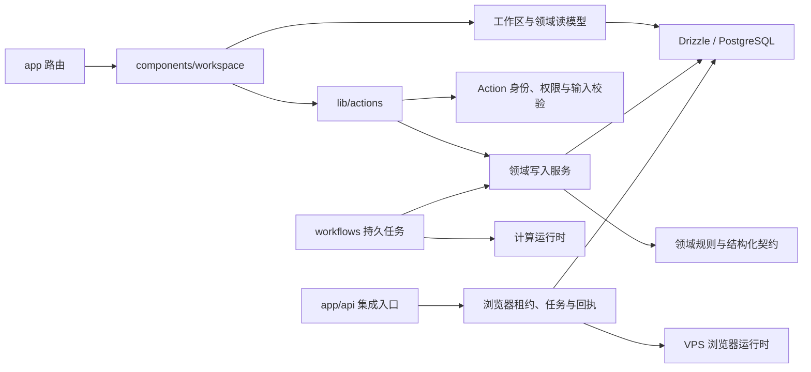

# 架构治理进度与任务池

## 依赖基线

#1136 的基线为 `8e047ff`。在独立 worktree 用 Understand Anything 的 `scan-project.mjs` 枚举文件，`extract-import-map.mjs` 解析库内引用，再对文件图计算强连通分量。清单共 1,352 个文件，716 个文件有可解析的库内 import，共 3,037 条去重有向边。扫描排除了原始数据、扫描件、生成的数据库快照、历史测试报告和部分 fixture。静态 import 包括类型引用；运行时动态装载、HTTP、数据库触发、CI 调度、Shell 子进程和其他跨进程调用需要独立核查。以下图中工作流、持久化和服务调用另经入口及架构记录核对。

`lib/db/client.ts`（155 个直接导入文件）、`lib/db/schema.ts`（130 个）和 `lib/workspace/access.ts`（52 个）是变更影响较大的接口，计数包含测试。审查表结构或授权改动时应沿具体读写路径核对调用方；导入次数本身不能证明模块需要拆分。

## #1156 人工目录录入与修订

人工创建与修订的两个 Server Action 均调用 `lib/product/evidence-bound-catalog.ts`。旧入口将一条引用赋给整组字段；库内导入、动态加载、测试及工具检索均未发现调用方。删除旧构造器、写事务及仅用来推导其参数的 schema。产品 Agent 有独立的来源契约，继续通过其写入服务创建待审草稿。已有记录沿用原读取和审核逻辑，无数据库迁移。

变更前后的目录测试覆盖缺少字段证据、审核版本及审批标识。真实 PostgreSQL 合成测试验证并发修订、证据保留、私有图片绑定及会话失效后事务回滚。本批不涉及营销视频内容。

### 目录依赖快照

[目录节点清单](directories.csv)与[有向依赖和基线权重](directory-edges.csv)记录 #1161 的 `632620e` 工作树，沿用 `8e047ff` 的扫描器与排除规则。共扫描 1,359 个文件，726 个文件有可解析的库内导入。3,125 条文件边中，813 条位于同一目录组，2,312 条跨组，覆盖 76 个目录组和 240 个有向目录对。例如 `components/workspace → components/ui` 的 317 条边来自 65 个组件文件，引用 26 个基础组件文件。

权重按不同的源文件和目标文件组合计数；测试与类型导入均参与计数。目录按主目录及首层业务子目录分组，目录直属文件标记为 `(root)`。65 个 `.mts` 进入清单，但该解析器未给出它们的出边。查看这类文件的影响面需另查编译器、实际入口和动态装载。快照用于定位修改范围，运行时无环约束见 #1146。

### 查询当前 TypeScript 文件的依赖关系

在仓库根目录运行 `pnpm --silent architecture:dependencies lib/actor-session.ts`，可得到该文件直接依赖和直接被依赖的已跟踪文件。不带路径时输出完整的 JSON 邻接表，可重定向到仓库外分析；尚未加入 Git 索引的新文件不在输出中。

该命令用项目本地 TypeScript、当前 tsconfig 和英文 `--explainFiles` 读取编译器实际解析的路径。它包含类型引用、路径别名与编译器识别的字面量动态导入；无库内出边的文件也保留为空数组。类型错误导致命令失败。HTTP、数据库与跨进程关系见运行边界表。运行时循环门禁仍由 `pnpm test:import-cycles` 执行。

在 `3c79177` 上，编译器视图包含 948 个已跟踪文件、3,340 条库内文件边。65 个 `.mts` 均可查询，其中 55 个有库内出边，合计 256 条。与目录快照的提交、文件范围及解析方式均不同，两个总数不用于衡量重构收益。CI 以临时 TypeScript 项目检验类型导入、路径别名、带空格文件名的动态导入、孤立节点与跟踪清单过滤。

## 状态与规则归属

| 业务概念 | 权威来源、写入边界 | 调用方、投影与现有检查 |
| --- | --- | --- |
| 产品与工程事实 | `lib/product/verification.ts`、证据位置与字段审核实现，以及人工审核的聚合版本。来源文件和媒体由上传回执关联 | 产品工作台、内容和视频读取已审核事实。参见 ADR 0010、`scripts/test-product-field-review.ts` |
| 聚合转换与人工门禁 | `lib/workflow/transitions.ts` 校验转换及批准，`orchestrator.ts` 为通用事务入口。业务专用 store 也会写状态、事件和版本 | `contracts/workflow/` 提供跨边界契约。`scripts/test-workflow-transitions.ts` 验证状态和重放 |
| RFQ、报价、交期 | `lib/rfq/`、`lib/quotation/`、`lib/delivery/` 各自拥有完整度、人工报价与交期规则。`lib/sales/store.ts` 和 `closing-store.ts` 管理项目关联和事务 | `lib/sales/journey.ts` 将记录投影为下一步任务。批准、发送登记和凭据检查各有独立含义 |
| 线索评分与跟进 | `lib/follow-up/` 计算分数和下一步动作。`lib/sales/closing-store.ts` 将证据与结果写入 lead 载荷 | `contracts/sales/lead.schema.json` 约束交换格式。工作台提供选择、显示已保存结果；历史载荷兼容性应独立验证 |
| 项目、成员、任务 | 项目及成员表记录所有权；`lib/workspace/access.ts` 校验项目访问和证据范围。`store.ts` 读取快照，`task-model.ts` 推导任务 | 工作台列表和对象详情读取投影。项目级授权由写入口再次校验 |
| 内容、视频和发布 | 内容审核、视频任务与发布回执分别由 `lib/content/`、`lib/video/`、`lib/social/` 管理；`workflows/` 编排可恢复执行 | 人工审批、媒体权利、发布协议、对象存储和保留期限约束不同阶段。计算服务故障不得自动触发跨提供商重试 |
| 浏览器任务与会话 | `lib/browser-fleet/` 管理租约、工作流调度、回执和恢复；`ops/browser-node/` 承接浏览器执行 | HTTP 与持久工作流是跨进程边界。计算任务与常驻浏览器分别使用独立运行时，见 `vercel-compute-return.md` |
| 身份、缓存与审计 | Better Auth 提供会话，`lib/authz.ts` 提供权限，`lib/action-boundary.ts` 处理 Action 身份和刷新；产品和内容写入在领域事务中追加审计事件 | 数据库是持久状态来源。页面、客户端表单和 Next 缓存是读写界面。PostgreSQL 的事务和锁需要数据库集成测试 |

## #1164 表单规则归属

旧的 `lib/form-schemas.ts` 汇集登录、产品、内容、销售与视频校验；登录入口经它依赖报价、计分和产品图片契约。业务表单现按所属领域直接导入，登录与邀请只依赖身份表单及 Zod。源资料或证据引用的共同规则归属 `lib/evidence/form-reference.ts`。视频设置与任务提交共用能力目录，剪辑、导出和发布配置共用平台值域；各平台能否实际发布仍由对应策略决定。

仓内无调用方的视频项目表单已删除。单场景视频草稿表单的生产 Action 已在 `8eda77c` 移除，其孤立测试已迁至现用创建入口，保留权利、已核实字段与平台的拒绝场景。27 个在用 schema 的 432 组迁移前后比较覆盖解析结果、输出和错误路径与消息。视频供应商、能力、画幅的一致性另有 CI 回归。本批没有更改视频脚本、素材选择、品牌、CTA 或平台规则，营销视频创意审查不适用。

## #1154 脚本类型检查

基线配置逐项列出 15 个脚本。扩展检查到全部已跟踪的 64 个 `.mts` 文件后，14 个文件暴露 28 条诊断。项目改用 `**/*.mts` 并在现有 noEmit 配置下允许显式 TypeScript 扩展名，使 Node 与模块模拟器继续使用同一模块标识。现有 PR 类型检查会自动纳入以后新增的脚本。

以编译器文件清单对照 Git 跟踪清单确认覆盖；无增量缓存的类型检查通过。10 个修改过的测试脚本在本地通过，其中 7 个连接合成 PostgreSQL。保留期恢复脚本仅增加类型注解，容器恢复演练由 repository-validate 执行。本批未改变视频内容，创意审查不适用。

## 跨模块运行边界

| 修改范围 | 运行时所有权与验证入口 |
| --- | --- |
| 工作区列表与页面刷新 | `lib/workspace/read-model.ts` 使用 React cache 合并同次服务端渲染的读取。项目列表与任务查询使用参与者标识，设置管理页由 canManage 控制读取；产品创建页在项目写入权限检查后只读取 #1161 的五个模型选择字段。写入方通过 `revalidatePath` 刷新对应界面。核对调用方的刷新范围及项目页回填行为。 |
| 上传与私有证据 | `lib/evidence/store.ts` 定义对象读写接口，`vercel-private-blob.ts` 管理真实对象，`memory-store.ts` 提供内存实现。上传、数据库关联和清理涉及两个持久系统，核对 `persist-upload.ts`、`upload-reconciliation.ts` 和实际上传事务测试。 |
| 任务与计算 | `workflows/` 有目录导入、视频、浏览器和人工门禁入口。计算运行时按配置选择 Vercel 或 VPS；服务端协议由 `ops/vps-runtime/` 实现。镜像、传输和容量测试分别验证不同边界。运行时选择及重试限制见[计算运行时决策](vercel-compute-return.md)。 |
| 业务审计与运行诊断 | 产品和内容存储在同一 PostgreSQL 事务内写业务记录与 auditEvent。产品流的请求诊断由 `lib/product/intake-diagnostics.ts` 管理，真实 Action 回归覆盖私有错误脱敏。基线中的 `lib/audit/append.ts` 只有两个导出，库内未找到调用方；不可用该模块推断事务审计覆盖率。 |
| 前端交互与表单 | `components/ui/` 承接组件原语，`components/workspace/` 组合具体流程。持久化由 Action 复核身份与输入；`tests/e2e/` 核对合成界面，`tests/database-browser/` 覆盖连接数据库的交互。 |
| 接口与工作进程 | `app/api/` 除认证入口外还含产品流、文件上传与下载、工作流回调及社交 Worker 回执。跨进程请求要沿 HTTP 处理器、领域事务和持久化回执追踪；静态导入图不会展示这类关系。 |

编号决策、被取代的导航决策和实验范围见[决策索引](../decisions/README.md)。同编号的两项历史决策保留原链接。本批仅修订架构地图及其校验，营销视频创意审查不适用。

## 技术方案与依赖例外

- Next App Router、React、ui-sdk 及 Tailwind 承担界面。表单经 React Hook Form 和共享 Zod schema 进入 Server Action。HTTP Route Handler 另承接鉴权、流式响应、媒体交付和外部集成等 HTTP 契约。
- PostgreSQL、Drizzle 及版本化迁移承担持久化。`lib/db/client.ts` 默认采用支持事务的 Neon Pool，同时允许回环地址上的原生 pg 传输。删除任一适配器会影响部署或数据库测试。
- `lib/compute/runtime.ts` 的 Vercel 默认提供商与显式 VPS 回退保留运维契约。生产运行证据由部署与 smoke 记录给出，单元测试只覆盖选择和调用契约。
- JSON Schema 面向结构化交换，Zod 面向应用请求。两侧有相同值域时，先核对字段语义、可选性与版本，再决定共用数据源或做契约一致性测试。
- 现有 CI 的 `repository-validate.yml` 执行仓库校验、模块测试及格式检查。生产构建、浏览器测试和镜像测试由其他 workflow 管理。运行时行为和历史数据兼容性需要匹配其影响面的检查。

## #1158 产品模型供应商契约

配置页、表单、Harbor、两项评估工具和 Python 结果验收从 `lib/ai/model-providers.json` 获取供应商标识。标签与顺序归属同一份目录，Zod 据此构造允许值。GitHub 手动工作流要求静态选项，仓库门禁核对其值与顺序。各环境的凭据映射按各自契约保留；已保存配置、运行时 SDK 选择和数据库约束均沿用既有语义。

Chromium 验证四个可见标签、顺序、选择切换与既有配置回填。合成测试核对缺失凭据、未知供应商与错误说明。本批不触及视频创意内容。

## 治理记录与任务池

| 进度 | 证据 | 决策或下轮验收 |
| --- | --- | --- |
| #1136 线索评分 | 基线中 YAML、领域计分、表单规则集合与工作台积分选项分别维护权重或标识符 | 同批迁移评分、输入和显示调用方；固定权重、边界、封顶、重复输入及证据顺序。政策校准交给产品决策 |
| 已归一：跟进上下文（#1143） | `cadence.ts`、`controlled-reply.ts`、`form-schemas.ts`、工作台选项与 lead 交换契约在初始基线分别列出六个上下文 | 六个场景归属 cadence，交换契约通过测试对照。排队后计划变更见 #1144 |
| 已归一：内部工作流词汇（#1140） | `lib/db/schema.ts`、`lib/workflow/transitions.ts` 和 `contracts/workflow/` 在初始基线分别声明 actor、聚合和门禁 | 内部枚举和新代码共享同一声明。历史 SQL 顺序和外部契约差异见 #1141 |
| #1136 初扫与 #1146 复核 | 多文件强连通分量共四组：record-page 与两个记录视图，AI model-provider 与 product-output-policy，workspace types 与 navigation，task-context 与 task-model | 各组至少一条必要回边为显式类型导入。初扫未覆盖全部动态导入。#1146 复核并消除实际运行时循环，现由仓库 Biome 门禁检查；适用范围见下文 |
| #1152 已治理共享错误边界；重试继续按服务核查 | 基线中的公共 `actionError` 将 Error.message 返回调用方；内容、视频等 Action 另有针对用户消息及隐私的测试。计算失败有明确的提供商选择约束 | 共享入口只展示标记为可公开的业务消息，输入校验在请求边界给出提示。真实 Action 回归覆盖含参数的数据库异常、内部校验与诊断改写。后续按不同服务核查副作用的重试语义 |
| 持续审查：工具与基础设施 | 当前门禁分布在 package scripts、仓库校验脚本及多个 CI workflow | 改动测试清单时核对实际执行命令、条件和数据库前提；独立验收未执行的项目保持待验证 |

本批涉及架构文档与线索评分数据来源，未触及视频素材、脚本、品牌或导出内容，营销视频 ABCD 创意审查不适用。

### #1167 产品模型名称选择

普通录入与目录录入现在从同一份选择数据生成交互，共享显示顺序及默认项。服务端用同一名称规则限制请求：模型名去除首尾空白、剔除空项，按配置内的首次出现顺序去重。配置 ID 仍是提交标识的一部分，两个配置中的同名模型各自独立。历史默认名带空白时现在可与其规范名称匹配。管理员保存的原始配置和数据库记录无需改写。

### #1166 后台任务的权限延续与撤销

人工目录导入、读取、重试及选择，以及人工发起的产品流创建和草稿持久化，在事务中锁定并校验现有授权，并在返回前复核会话自然到期；失败时回滚本次事务。后台目录解析和流结束记录沿用原执行契约。尚待确认的是后台任务在发起人的权限变更或撤销后，何时可继续、何时必须停止，以及该决定如何适用于已排队任务。

### #1161 产品录入的模型选择数据

管理页需要配置详情，产品录入只需模型选项。两个录入流程的生产入口现在通过同一 SQL 投影读取配置 ID、名称、默认标记、默认模型和已发现模型。筛选在数据库完成，API key 或 auth token 任意一项非空即可选；数据库只把五个选项字段返回应用。名称顺序、默认项和两个流程各自的历史模型字符串处理保持兼容。

合成 PostgreSQL 和 Chromium 回归在实际产品创建页验证可用配置与管理字段的序列化边界，并经过目录选择、已存进度恢复及会话过期写入检查。本批不涉及视频内容。

### #1150 事务内的调用者身份

`lib/actor-session.ts` 定义 actor/session 身份、带项目标识的严格输入契约以及读取当前用户和会话并持有共享锁的查询。八个原本逐字重复该查询的事务路径使用同一实现。权限判定、错误文案与到期检查继续在领域事务里执行，以便等待其他锁后再次判断有效期。目录导入和产品流使用相同身份类型，保留其带 SQL 过滤条件的专用查询；浏览器检查从 session 一侧起查并继续沿用其加锁顺序。

产品 Agent、产品审核、内容草稿、内容审核、视频草稿、视频审核、社交写入和文档上传八组独立 PostgreSQL 回归通过。严格输入测试覆盖 UUID、标识裁剪和额外字段拒绝。此改动只涉及身份契约与数据库读取，营销视频创意审查不适用。

### #1136 评分规则决策与验证

`lib/follow-up/lead-scoring.ts` 持有规则 ID、工作台标签、权重和分档门槛。选择 TypeScript 字面量列表，让 Zod、计分和客户端共用规则 ID 的联合类型。另一方案是在构建时从 YAML 生成客户端模块，但会增加生成步骤与过期产物检查。仓库中原 YAML 的唯一读取方为 Python 校验器；同一 CI 已执行评分行为测试。历史 lead 继续保存当时的 score、score_band 和 score_reasons，读取时不会按当前规则重新评分。

评分基线覆盖八条规则的 256 个子集、最高原始分 110、封顶 100、重复输入、未知输入与证据顺序。另修复旧计分函数会将对象原型上的名称识别成规则的问题：例如传入 `constructor` 曾产生 NaN 并误分到 HOT。共享表单原本就拒绝此类值。Chromium 合成跟进页验证了历史选择的回填、首次编辑与保存按钮启用；Next 开发诊断无错误。

### 后续批次

| 批次 | 决策与验证证据 |
| --- | --- |
| #1148 项目成员权限 | 成员管理、查看、写入和回执使用同一套角色定义。每个事务继续独立核对应用权限、项目状态、成员与业务对象，归档回执与普通写入分别处理。PostgreSQL 17 合成回归覆盖项目归档并发锁、内容、上传、视频审核、社交及跟进。Drizzle 无迁移。 |
| #1138 校验器 | 24 次 pnpm 调用共用一个执行入口；带本地断言的检查仍独立拥有断言。旧版与新版对比了成功路径及逐项注入的首个失败，命令、参数、顺序和已完成检查的输出一致。完整验证器通过。 |
| #1140 工作流词汇 | 内部 actor、aggregate、gate 在领域模块中声明，Drizzle、工作区和工作流复用；测试分别核查交换契约的完整集合和子集。生成器检查 43 张表后无需迁移。历史 SQL 的 video 排序及外部 schema 范围待 #1141 决策。 |
| #1143 跟进场景 | cadence 管理六个场景与建议，表单、工作台、销售事务、回复生成及 Worker 领取使用同一值域或 Gate 03 条件。价格异议需要人工升级，交期确认只适用于样品及交期场景。测试覆盖六种场景和 lead 外部契约。 |
| #1144 待确认 | 消息入队时固定正文，领取时读取可独立更新的线索计划。历史任务能否重建对应审批依据，以及无法重建时如何处置，需产品确认。 |

### #1146 动态导入与循环依赖

静态文件图未计入所有延迟导入。用 Biome 项目解析器复查应用及工作流等六个目录，在 527 个文件中发现 9 条参与循环的导入边。发布资格检查现归属 `lib/social/publication-eligibility.ts`，发布预约归属 `lib/browser-fleet/publication-scheduling.ts`；写入、执行和回执沿用原事务与锁。持久工作流在 wake step 内向投递服务传入自身的已编译引用，工作流参数仍只序列化节点与操作标识。编译运行测试核对该引用可用于启动同一个工作流。

`pnpm test:import-cycles` 对 Biome 配置纳入的整个仓库执行检查，CI 对 PR 执行同一命令。相对路径、项目别名、延迟字面量导入组成的合成循环均触发失败，移除夹具后通过。类型专用导入、运行时计算路径、HTTP 和跨进程调用不在该规则的完整证明范围内。此变更仅调整代码依赖方向，营销视频创意审查不适用。

### #1141 通用交换契约与实库枚举

通用 workflow-event 与 human-approval 交换契约暂时维持各自现有的范围。内部 video 聚合继续使用已有视频领域契约。2026-11-28 通过项目配置的 Neon 连接，在只读事务中查询 public.aggregate_type 的 pg_enum，按 enumsortorder 从 1 到 7 得到 product、content、rfq、quotation、lead、delivery_confirmation、video，与历史迁移 0004 追加 video 一致。此次取证没有读取业务表，连接的部署环境标签未单独核验。

领域元组和 Drizzle 声明按该顺序排列。0046 只核验目录顺序并推进生成器快照，遇到不同顺序时停止供人工取证。没有重建枚举或转换业务列。
