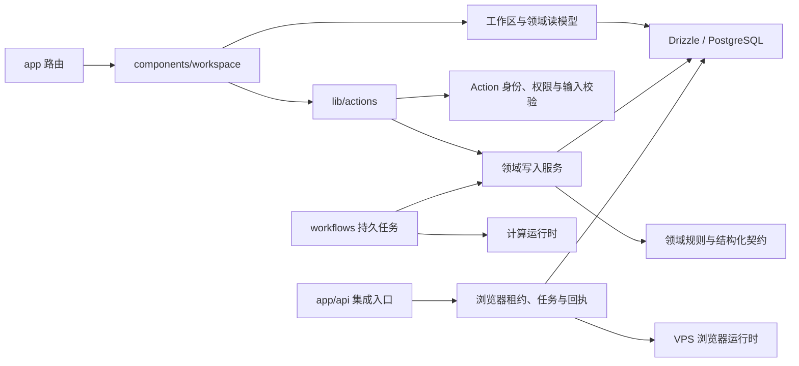

# 架构治理进度与任务池

## 依赖基线

#1136 的基线为 `8e047ff`。在独立 worktree 用 Understand Anything 的 `scan-project.mjs` 枚举文件，`extract-import-map.mjs` 解析库内引用，再对文件图计算强连通分量。清单共 1,352 个文件，716 个文件有可解析的库内 import，共 3,037 条去重有向边。扫描排除了原始数据、扫描件、生成的数据库快照、历史测试报告和部分 fixture。静态 import 包括类型引用；运行时动态装载、HTTP、数据库触发、CI 调度、Shell 子进程和其他跨进程调用需要独立核查。以下图中工作流、持久化和服务调用另经入口及架构记录核对。

`lib/db/client.ts`（155 个直接导入文件）、`lib/db/schema.ts`（130 个）和 `lib/workspace/access.ts`（52 个）是变更影响较大的接口，计数包含测试。审查表结构或授权改动时应沿具体读写路径核对调用方；导入次数本身不能证明模块需要拆分。

## 状态与规则归属

| 业务概念 | 权威来源、写入边界 | 调用方、投影与现有检查 |
| --- | --- | --- |
| 产品与工程事实 | `lib/product/verification.ts`、证据位置与字段审核实现，以及人工审核的聚合版本。来源文件和媒体由上传回执关联 | 产品工作台、内容和视频读取已审核事实。参见 ADR 0010、`scripts/test-product-field-review.ts` |
| 聚合转换与人工门禁 | `lib/workflow/transitions.ts` 校验转换及批准，`orchestrator.ts` 为通用事务入口。业务专用 store 也会写状态、事件和版本 | `contracts/workflow/` 提供跨边界契约。`scripts/test-workflow-transitions.ts` 验证状态和重放 |
| RFQ、报价、交期 | `lib/rfq/`、`lib/quotation/`、`lib/delivery/` 各自拥有完整度、人工报价与交期规则。`lib/sales/store.ts` 和 `closing-store.ts` 管理项目关联和事务 | `lib/sales/journey.ts` 将记录投影为下一步任务。批准、发送登记和凭据检查各有独立含义 |
| 线索评分与跟进 | `lib/follow-up/` 计算分数和下一步动作。`lib/sales/closing-store.ts` 将证据与结果写入 lead 载荷 | `contracts/sales/lead.schema.json` 约束交换格式。工作台提供选择、显示已保存结果；历史载荷兼容性应独立验证 |
| 项目、成员、任务 | 项目及成员表记录所有权；`lib/workspace/access.ts` 校验项目访问和证据范围。`store.ts` 读取快照，`task-model.ts` 推导任务 | 工作台列表和对象详情读取投影。项目级授权由写入口再次校验 |
| 内容、视频和发布 | 内容审核、视频任务与发布回执分别由 `lib/content/`、`lib/video/`、`lib/social/` 管理；`workflows/` 编排可恢复执行 | 人工审批、媒体权利、发布协议、对象存储和保留期限约束不同阶段。计算服务故障不得自动触发跨提供商重试 |
| 浏览器任务与会话 | `lib/browser-fleet/` 管理租约、工作流调度、回执和恢复；`ops/browser-node/` 承接浏览器执行 | HTTP 与持久工作流是跨进程边界。计算任务与常驻浏览器分别使用独立运行时，见 `vercel-compute-return.md` |
| 身份、缓存与审计 | Better Auth 提供会话，`lib/authz.ts` 提供权限，`lib/action-boundary.ts` 处理 Action 身份和刷新；`lib/audit/append.ts` 写审计 | 数据库是持久状态来源。页面、客户端表单和 Next 缓存是读写界面。PostgreSQL 的事务和锁需要数据库集成测试 |

## 技术方案与依赖例外

- Next App Router、React、ui-sdk 及 Tailwind 承担界面。表单经 React Hook Form 和共享 Zod schema 进入 Server Action。HTTP Route Handler 另承接鉴权、流式响应、媒体交付和外部集成等 HTTP 契约。
- PostgreSQL、Drizzle 及版本化迁移承担持久化。`lib/db/client.ts` 默认采用支持事务的 Neon Pool，同时允许回环地址上的原生 pg 传输。删除任一适配器会影响部署或数据库测试。
- `lib/compute/runtime.ts` 的 Vercel 默认提供商与显式 VPS 回退保留运维契约。生产运行证据由部署与 smoke 记录给出，单元测试只覆盖选择和调用契约。
- JSON Schema 面向结构化交换，Zod 面向应用请求。两侧有相同值域时，先核对字段语义、可选性与版本，再决定共用数据源或做契约一致性测试。
- 现有 CI 的 `repository-validate.yml` 执行仓库校验、模块测试及格式检查。生产构建、浏览器测试和镜像测试由其他 workflow 管理。运行时行为和历史数据兼容性需要匹配其影响面的检查。

## 治理记录与任务池

| 进度 | 证据 | 决策或下轮验收 |
| --- | --- | --- |
| #1136 线索评分 | 基线中 YAML、领域计分、表单规则集合与工作台积分选项分别维护权重或标识符 | 同批迁移评分、输入和显示调用方；固定权重、边界、封顶、重复输入及证据顺序。政策校准交给产品决策 |
| 待验证：跟进上下文 | `cadence.ts`、`controlled-reply.ts`、`form-schemas.ts`、工作台选项与 lead 交换契约都列出六个上下文 | 核对外部协议，保留已存上下文和 Gate 03 检查，评估能否从既有交换契约派生值域。下一步动作与上下文应独立建模 |
| 待验证：工作流词汇 | `lib/db/schema.ts`、`lib/workflow/transitions.ts` 和 `contracts/workflow/` 分别声明 actor、聚合和门禁 | 比较枚举成员、数据库排序、历史迁移与外部契约。先取证再决定由类型派生或用一致性测试约束 |
| 已排查：静态环 | 多文件强连通分量共四组：record-page 与两个记录视图，AI model-provider 与 product-output-policy，workspace types 与 navigation，task-context 与 task-model | 各组至少一条必要回边为显式类型导入。当前扫描没有发现可由这些边形成的运行时循环。后续门禁需要识别值导入、类型导入及重导出 |
| 待核查：错误与重试 | 公共 `actionError` 将 Error.message 返回调用方；内容、视频等 Action 另有针对用户消息及隐私的测试。计算失败有明确的提供商选择约束 | 沿调用源区分领域错误、远端失败和私有诊断，再评估共享处理的范围。测试用户可见字段、诊断和副作用的重试语义 |
| 持续审查：工具与基础设施 | 当前门禁分布在 package scripts、仓库校验脚本及多个 CI workflow | 改动测试清单时核对实际执行命令、条件和数据库前提；独立验收未执行的项目保持待验证 |

本批涉及架构文档与线索评分数据来源，未触及视频素材、脚本、品牌或导出内容，营销视频 ABCD 创意审查不适用。

### #1136 评分规则决策与验证

`lib/follow-up/lead-scoring.ts` 持有规则 ID、工作台标签、权重和分档门槛。选择 TypeScript 字面量列表，让 Zod、计分和客户端共用规则 ID 的联合类型。另一方案是在构建时从 YAML 生成客户端模块，但会增加生成步骤与过期产物检查。仓库中原 YAML 的唯一读取方为 Python 校验器；同一 CI 已执行评分行为测试。历史 lead 继续保存当时的 score、score_band 和 score_reasons，读取时不会按当前规则重新评分。

评分基线覆盖八条规则的 256 个子集、最高原始分 110、封顶 100、重复输入、未知输入与证据顺序。另修复旧计分函数会将对象原型上的名称识别成规则的问题：例如传入 `constructor` 曾产生 NaN 并误分到 HOT。共享表单原本就拒绝此类值。Chromium 合成跟进页验证了历史选择的回填、首次编辑与保存按钮启用；Next 开发诊断无错误。

### 后续批次

| 批次 | 决策与验证证据 |
| --- | --- |
| #1138 校验器 | 24 次 pnpm 调用共用一个执行入口；带本地断言的检查仍独立拥有断言。旧版与新版对比了成功路径及逐项注入的首个失败，命令、参数、顺序和已完成检查的输出一致。完整验证器通过。 |
| #1140 工作流词汇 | 内部 actor、aggregate、gate 在领域模块中声明，Drizzle、工作区和工作流复用；测试分别核查交换契约的完整集合和子集。生成器检查 43 张表后无需迁移。历史 SQL 的 video 排序及外部 schema 范围待 #1141 决策。 |
| #1143 跟进场景 | cadence 管理六个场景与建议，表单、工作台、销售事务、回复生成及 Worker 领取使用同一值域或 Gate 03 条件。价格异议需要人工升级，交期确认只适用于样品及交期场景。测试覆盖六种场景和 lead 外部契约。 |
| #1144 待确认 | 消息入队时固定正文，领取时读取可独立更新的线索计划。历史任务能否重建对应审批依据，以及无法重建时如何处置，需产品确认。 |

### #1146 动态导入与循环依赖

静态文件图未计入所有延迟导入。用 Biome 项目解析器复查应用及工作流等六个目录，在 527 个文件中发现 9 条参与循环的导入边。发布资格检查现归属 `lib/social/publication-eligibility.ts`，发布预约归属 `lib/browser-fleet/publication-scheduling.ts`；写入、执行和回执沿用原事务与锁。持久工作流在 wake step 内向投递服务传入自身的已编译引用，工作流参数仍只序列化节点与操作标识。编译运行测试核对该引用可用于启动同一个工作流。

`pnpm test:import-cycles` 对 Biome 配置纳入的整个仓库执行检查，CI 对 PR 执行同一命令。相对路径、项目别名、延迟字面量导入组成的合成循环均触发失败，移除夹具后通过。类型专用导入、运行时计算路径、HTTP 和跨进程调用不在该规则的完整证明范围内。此变更仅调整代码依赖方向，营销视频创意审查不适用。
